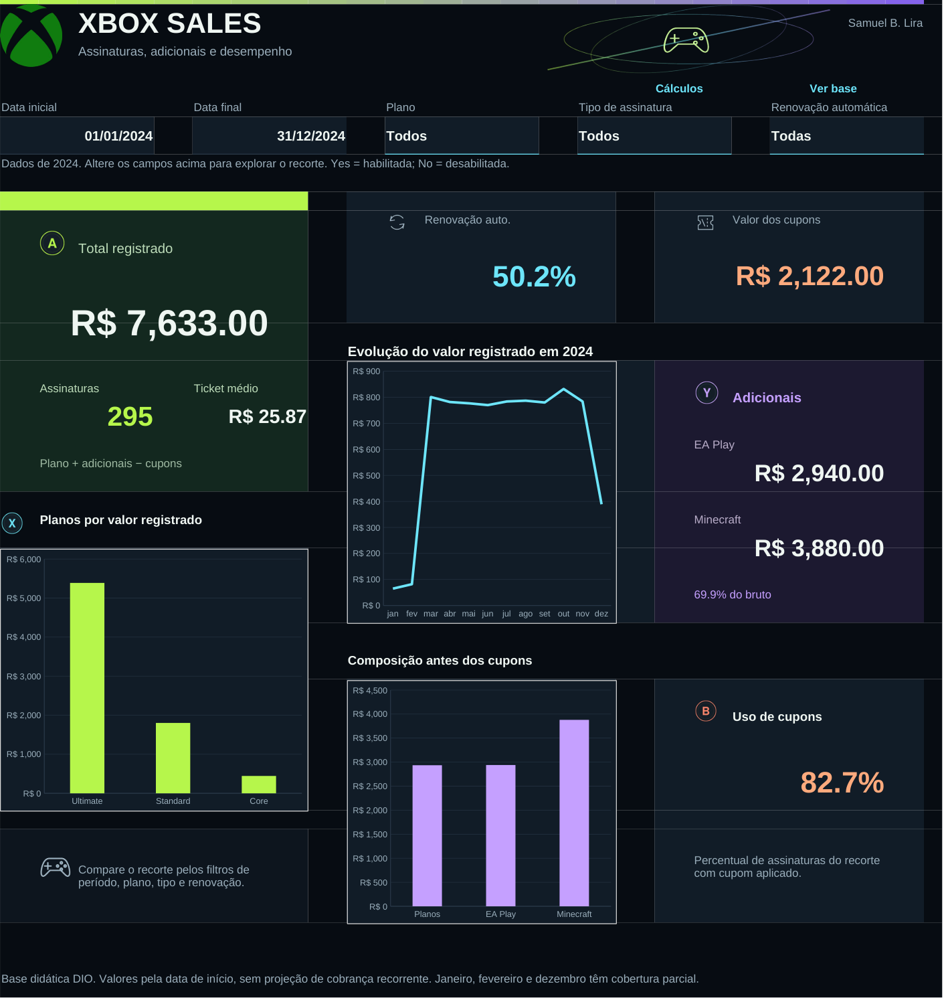

# Xbox Sales

Dashboard de vendas de assinaturas e adicionais, desenvolvido no Excel para o desafio da DIO.

**Autor:** Samuel B. Lira. Projeto educacional desenvolvido com assistência de IA, usando a base didática do curso. Não é um relatório oficial da Microsoft ou do Xbox.

## O que o painel responde

O painel permite acompanhar o total registrado, a quantidade de assinaturas, o ticket médio e a parcela com renovação automática habilitada. Os gráficos mostram a evolução mensal de 2024, o ranking dos planos e a composição do valor bruto. EA Play, Minecraft e cupons têm seus próprios resumos.

A interface foi criada do zero, com tema dark, composição assimétrica, logo Xbox nas três abas, ícones de controle e destaques em verde elétrico, ciano e violeta. O total ocupa um painel vertical, os adicionais têm uma área própria e os gráficos permanecem nativos do Excel. O arquivo finalizado da aula foi consultado para compreender o escopo. Seu layout, imagens e objetos não foram copiados.

## Como usar

1. Baixe [Xbox_Sales.xlsx](Xbox_Sales.xlsx) e abra no Excel desktop.
2. Na aba **Painel**, ajuste as datas inicial e final nos campos brancos com linha verde.
3. Escolha o plano, o tipo de assinatura e a opção de renovação nas listas suspensas. Todos os indicadores e gráficos utilizam o mesmo recorte.
4. Para voltar à visão completa, use 01/01/2024 a 31/12/2024, **Todos**, **Todos** e **Todas**.
5. Use **Cálculos** para conferir os passos e **Ver base** para examinar os registros. As abas de apoio possuem um link de volta ao painel.

As listas do painel são validações de dados. A tabela da Base também permite filtrar e ordenar linhas para consulta, mas seus filtros não substituem os controles do painel. O arquivo não usa macros, login, conexão externa ou atualização por API.

## Os dados utilizados

A [base original fornecida pela DIO](data/base.xlsx) contém 295 registros, com IDs únicos e datas de início de 01/01/2024 a 16/12/2024. Foram preservados os 13 campos originais, incluindo plano, tipo, renovação automática, preços, adicionais e cupons. O hífen em preço de EA Play é tratado como ausência do adicional e convertido em zero na aba de cálculos, sem alterar a fonte.

| Medida na base completa | Resultado |
|---|---:|
| Assinaturas | 295 |
| Preço dos planos | R$ 2.935,00 |
| EA Play | R$ 2.940,00 |
| Minecraft | R$ 3.880,00 |
| Valor bruto | R$ 9.755,00 |
| Cupons | R$ 2.122,00 |
| Total registrado | R$ 7.633,00 |

A moeda segue a formatação da planilha de origem. Não foram acrescentadas transações ou metas fictícias ao dashboard.

## Como os números são calculados

O total registrado corresponde a **preço do plano + EA Play + Minecraft − cupom**. O ticket médio divide esse total pela quantidade de registros selecionados. A participação dos adicionais usa o valor bruto, antes dos cupons, porque a fonte não informa como distribuir cada desconto entre os produtos.

Renovação automática significa somente que a opção está habilitada no cadastro. A base não comprova renovação efetiva, retenção ou cancelamento. Os valores não são multiplicados por 12, 3 ou qualquer outra duração: não há calendário de cobranças para fundamentar esse cálculo. A evolução mensal usa a data de início, não uma data de recebimento financeiro.

Quando não há registros no recorte, os totais e contagens mostram zero, e as médias e proporções mostram `n.a.`. Datas ou opções inválidas geram um aviso e deixam os indicadores indisponíveis.

## Estrutura e reprodução

- **Painel:** filtros, indicadores e três gráficos nativos editáveis.
- **Calculos:** passos por registro, agregações que alimentam os gráficos e conciliação da base.
- **Base:** dados originais em uma tabela com filtros e cabeçalhos congelados.

Os cálculos usam SE, SOMA, SOMASES, CONT.SES, ÍNDICE e CORRESP. O ranking é calculado a partir do total filtrado, com desempate estável. Para reproduzir a análise, abra a planilha, restaure os filtros completos e confira os resultados na tabela acima. Os intervalos, regras e a rotina de atualização estão em [docs/CALCULOS.md](docs/CALCULOS.md).

Novos registros podem ser inseridos na sequência da Base até a linha 1006, mantendo a ordem e os tipos dos campos. Há capacidade de cálculo para 1.000 registros. A evolução mensal está delimitada a 2024, o ano da fonte; para dados de outros anos, ajuste também o calendário documentado. Acima de 1.000 registros, amplie os intervalos e fórmulas antes de usar o painel.

## Documentação

- [Schema escrito antes da implementação](SCHEMA.md)
- [Cálculos, filtros e atualização](docs/CALCULOS.md)
- [Verificações realizadas e limites](docs/VALIDACAO.md)
- [Fontes e decisões de autoria](docs/REFERENCIAS.md)

## Experiência

O planejamento começou pelas perguntas de negócio e pela conferência da base. O principal cuidado foi preservar o significado dos valores e aplicar o mesmo recorte aos indicadores e gráficos. Em relação aos projetos anteriores, a proposta visual mudou para um tema dark com painéis assimétricos, logo Xbox e ícones de controle. A autorização de reaproveitamento do KAS One não foi necessária: nenhum código ou ativo daquele sistema foi incorporado.

Este repositório documenta a implementação. Assistir às aulas e apresentar a própria compreensão do trabalho continuam sendo etapas individuais do curso.
